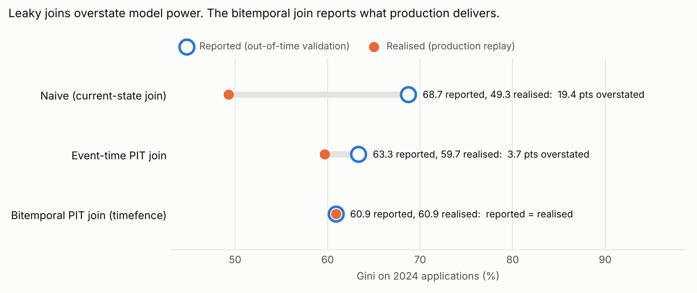
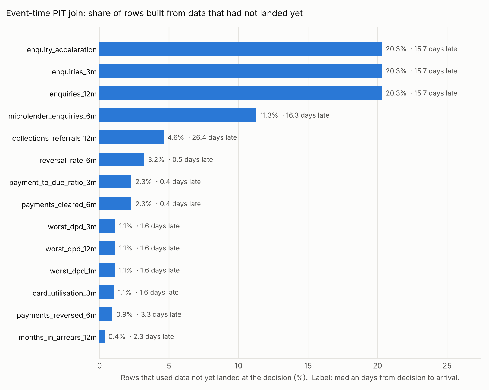
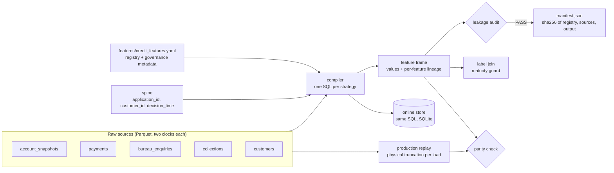

# timefence

**A point-in-time correct credit feature store that stops future data leaking into model training.**

Credit models are trained on what happened, but they are used on what was *known*. Those are different
things. A bureau file lands two weeks after the enquiries in it were made. A debit order clears tonight
and bounces next Tuesday. A collections referral is back-dated to the day the arrears began. Join on
event time alone and the training set quietly contains facts that no live decision could have seen.
The model looks better on paper than it will ever be in production.

`timefence` builds every training row from exactly what the warehouse knew at the moment of the
decision. It then **proves** this by replaying production. The replay rebuilds the warehouse one load at
a time and checks that the offline features match the replay row for row.



The same gradient-boosted model is trained three times on 12,186 synthetic applications (2022-2023).
It is validated out-of-time on 7,075 applications from 2024 ("reported"). The same 2024 applications
are then scored with the features production would really have served ("realised"):

| Feature join | Reported Gini | Realised Gini | Overstated by (95% CI) | Bad rate promised at 80% approval | Bad rate delivered at that cut-off |
|---|---|---|---|---|---|
| Naive (current-state table) | 68.7 | 49.3 | 19.4 pts (15.8 to 22.7) | 4.7% | 6.6% |
| Event-time point-in-time join | 63.3 | 59.7 | 3.7 pts (2.4 to 5.1) | 4.9% | 5.9% |
| **Bitemporal join (timefence)** | **60.9** | **60.9** | **0.0** | **5.5%** | **5.5%** |

Three things stand out:

- **The textbook join still leaks.** An event-time join is the usual meaning of "point-in-time
  correct". Here it overstates Gini by 3.7 points. It promises a 4.9% bad rate in the approved book and
  delivers 5.9%. Its cut-off also approves 83% of applicants instead of the planned 80%.
- **The honest model is the best model in production.** It looks the weakest in validation, but it
  delivers 60.9 against 59.7 and 49.3. Leaky features teach a model to lean on signals that do not exist at
  decision time. The event-time model ranks `collections_referrals_12m` as its third most important input.
  That is the back-dated referral that has not landed yet.
- **For the bitemporal join, "reported" and "realised" are identical, not just close.** The replay
  matched every one of 7,075 rows across 16 features exactly. Calibration tells the same story: the naive
  model's Brier score degrades from 0.076 to 0.091 in production, and the bitemporal model's stays at 0.080.

**Robustness.** The model is developed in January 2026 with every vintage whose 12-month window had
closed: train on 2022-2023, validate out-of-time on 2024. That is the usual scorecard design. A stricter
design trains only on vintages matured by 1 January 2024, as if the model had gone live that day. This
halves the training set to 5,707 rows, and the gaps hold: 15.4 points for naive, 3.1 for event-time and
0.0 for bitemporal.

All numbers come from `reports/results.json`. The full report is in [reports/leakage_report.md](reports/leakage_report.md).
The data is synthetic (see [what is synthetic](#what-is-synthetic-and-what-is-not)), so the figures show
how the mechanism behaves. They are not an estimate for any real portfolio.

---

## Why an event-time join leaks

Every source declares **two clocks**:

| Clock | Column (example) | Meaning |
|---|---|---|
| Valid time | `snapshot_at`, `paid_at`, `enquired_at`, `effective_at` | When the fact was true in the world |
| Knowledge time | `ingested_at` | When the warehouse first held this version of the fact |

An event-time join filters on valid time only, and it takes the latest version of each record. Anything
that happened before the decision but landed after it gets through. The synthetic data has four such
paths, each modelled on routine retail-credit plumbing:

| Arrival pattern | How it lands | Rows contaminated (event-time join) | Median days from decision to landing |
|---|---|---|---|
| Monthly bureau file | Enquiries for month M arrive on the 12th of M+1 | 20.3% of enquiry features | 15.7 |
| Back-dated collections referral | Effective date set to the start of arrears | 4.6% | 26.4 |
| Debit-order reversals, overnight payment loads | Same `payment_id` re-issued as `reversed` 3-10 days later; payments land the next night | 0.9-3.2% | 0.4-3.3 |
| Arrears restatements and late batches | Month-end snapshot restated (v2) once a reversal lands | 1.1% | 1.6 |



The late facts are not random. Customers heading into default shop for credit, bounce debit orders and
get referred to collections. They also apply for credit more often. So the rows that leak are the rows
that matter most.

## How it works



### The as-of rule

For every spine row (`customer_id`, `decision_time`), each source goes through three steps in a fixed order:

1. **Knowledge filter:** keep record versions with `ingested_at <= decision_time` (the instant of the
   load counts as known).
2. **Deduplicate:** per record key, keep the newest known version, ordered by `ingested_at` then
   `record_version`. This makes the tie-break deterministic.
3. **Window:** then apply the valid-time window, `decision_time - N days < event_time <= decision_time`.

Windowing before deduplicating looks harmless, but it can bring back a stale version whose valid time was
later corrected. There is a test for exactly that. The compiled SQL for one source looks like this
(see `timefence sql` for the full query):

```sql
known_account_snapshots AS (
    SELECT sp.__row_id, sp.__as_of, r.*
    FROM spine sp
    JOIN src_account_snapshots r
      ON r.customer_id = sp.customer_id
     AND r.ingested_at <= sp.__as_of                       -- 1. what was known
    QUALIFY row_number() OVER (
        PARTITION BY sp.__row_id, r.account_id, r.snapshot_at
        ORDER BY r.ingested_at DESC, r.record_version DESC  -- 2. newest known version, deterministic
    ) = 1
),
agg_account_snapshots AS (
    SELECT __row_id,
        max(dpd) FILTER (WHERE snapshot_at <= __as_of
                           AND snapshot_at > __as_of - INTERVAL 92 DAY) AS worst_dpd_3m,  -- 3. window
        max(ingested_at) FILTER (WHERE ...) AS __ing__worst_dpd_3m,  -- lineage for the audit
        ...
```

### Guarantees, and the test that holds each one

| Guarantee | How | Test |
|---|---|---|
| No fact is used before it landed | Bitemporal as-of rule above | `test_semantics.py` (8 hand-built cases) |
| Every feature value is auditable | Each value carries the max `event_time` and `ingested_at` of the rows behind it | `test_audit_passes_for_bitemporal_and_catches_the_other_strategies` |
| Offline equals what production saw | Replay rebuilds every source from the rows landed by each load, then runs the *plain* event-time query | `test_replay_parity` |
| Planted poison never reaches training | Absurd values (DPD 999) planted just before each decision, landing just after | `test_canary_poison_never_reaches_a_bitemporal_frame` |
| Values match an independent implementation | Hand-written pandas re-implementation of three features | `test_golden_values_match_a_hand_written_pandas_implementation` |
| Builds are reproducible bit-for-bit | Deterministic tie-breaks; sums and averages accumulate in exact decimals; sha256 manifest | `test_builds_are_reproducible_and_manifested` |
| Features are only used for approved purposes | `permitted_use` is mandatory; `province` is analytics-only (proxy risk) | `test_permitted_use_is_enforced` |
| No label is used before its window closes | `attach_labels` refuses immature labels | `test_label_maturity_guard` |
| One definition, offline and online | Online store is materialised from the same compiled query | `test_online_store_serves_the_offline_definition` |
| A failed online refresh never half-publishes | New snapshot staged beside the live one, then features and metadata swapped in one transaction | `test_failed_refresh_keeps_the_previous_snapshot_serving` |
| Odd names cannot break or inject SQL | Every identifier and literal goes through one quoting module (`_sql.py`) | `test_paths_and_identifiers_are_quoted` |
| Source contracts | Duplicate version keys, or rows landing before they happened, fail the load | `test_duplicate_version_keys_are_rejected` |

One finding came out of the reproducibility test. DuckDB sums floats in parallel, so two identical builds
differed in the 16th significant digit. That is harmless for a model, but it breaks any claim that a
training set can be reproduced and verified by hash. Sums and averages now accumulate in
`DECIMAL(38,12)` ([ADR-0003](docs/adr/0003-exact-decimal-aggregation.md)).

## Quickstart

```bash
git clone <this repo> && cd timefence
python -m venv .venv && source .venv/bin/activate
make install          # pip install -e ".[dev]"
make demo             # generate data, run the experiment, materialise online store, audit frames
make test             # 30 tests, ~20 seconds
```

`make demo` takes about a minute on a laptop. Individual commands:

```bash
timefence generate --customers 10000 --seed 7   # synthetic raw sources -> data/raw/
timefence build --strategy bitemporal           # frame + lineage + manifest -> data/frames/bitemporal/
timefence audit data/frames/event_time          # exits 1: leakage found
timefence audit data/frames/bitemporal          # exits 0
timefence sql --strategy bitemporal             # print the compiled query
timefence experiment                            # reported vs realised, writes reports/
timefence materialise --as-of "2025-12-31 23:00"
timefence lookup C000042
```

Use `timefence audit` as a gate in a training pipeline: a frame that fails it never reaches a model.

## Defining a feature

```yaml
- name: collections_referrals_12m
  source: collections            # declares event_time, ingested_at, record_key, version_col
  agg: count                     # count | sum | max | min | avg
  column: "1"
  window_days: 366
  default: 0
  description: Collections referrals with an effective date in the last 12 months.
  owner: credit-risk-features
  permitted_use: [credit_decisioning, model_development, analytics]

- name: reversal_rate_6m         # derived features inherit their inputs' lineage
  derived: payments_reversed_6m / nullif(payments_cleared_6m + payments_reversed_6m, 0)
  ...
```

The registry is validated on load. It rejects unknown sources, duplicate names, cycles between derived
features, non-positive windows and missing governance metadata. The registry's sha256 goes into every
manifest and into the online store, and `lookup` refuses to serve features built from a different
registry.

## Repository layout

```
features/credit_features.yaml   feature registry (17 features, 5 sources)
src/timefence/
  generate.py                   synthetic data with realistic arrival behaviour
  registry.py                   registry loading, validation, permitted use
  compiler.py                   registry -> DuckDB SQL (naive / event_time / bitemporal)
  _sql.py                       identifier and literal quoting used by every query
  store.py                      build frames, audit, manifests, label maturity guard
  replay.py                     production replay by physical truncation; parity check
  online.py                     SQLite online store
  experiment.py                 reported-vs-realised experiment, charts, report
  cli.py                        `timefence` command
tests/                          30 tests: semantics, leakage, governance
docs/adr/                       design decisions
docs/data_dictionary.md         sources, both clocks, arrival patterns
reports/                        generated results (committed so the README renders)
```

## Design decisions

- [ADR-0001: bitemporal as-of semantics](docs/adr/0001-bitemporal-as-of.md). Why knowledge time is a
  first-class column, and why the order filter, deduplicate, window is fixed.
- [ADR-0002: DuckDB and Parquet](docs/adr/0002-duckdb-and-parquet.md). Why a single-node engine for a
  portfolio rebuild, and how the design maps to Iceberg, Spark or Dremio.
- [ADR-0003: exact decimal aggregation](docs/adr/0003-exact-decimal-aggregation.md). Reproducibility
  over the last bit of float speed.

## Why it matters in a bank

- **Model risk.** Validation reports the reported column, while the business lives with the realised
  one. The gap shows up as approval rates drifting from plan and bad rates above what was promised. It
  surfaces months later, when the vintages mature.
- **Data governance (BCBS 239).** Accuracy, integrity and lineage need a training set that can be rebuilt
  and verified. Every frame here has a manifest with hashes of the registry, each source file and the
  output, and a per-value lineage of when its inputs were valid and when they were known.
- **POPIA purpose specification.** Features carry the purposes they are approved for. Asking for an
  analytics-only feature in a credit-decisioning build is an error, not a silent inclusion.

## What is synthetic and what is not

Everything in `data/` is generated by `generate.py` from a seeded random process: 10,000 customers,
about 15,500 accounts, 60 month-ends (2021-2025) and 20,000 applications, with a rate-cycle stress term
peaking in 2023. No real customer, account or institution data is used, and the identifiers are made
up. The arrival patterns are stylised versions of common retail-credit plumbing. The *size* of each
effect depends on the generator's parameters. The *direction* of each effect, and the parity guarantee,
do not.

Known simplifications:

- Arrears move in 30-day buckets.
- A partial loan payment counts as paid.
- Bureau data is consumed only from monthly files. A lender that pulls a live bureau report at
  application would declare that source with a near-zero landing lag, and the same machinery applies.
- DuckDB runs on a single node, and the online store is a SQLite table, not a low-latency service.
  For sources larger than RAM, `FeatureStore(in_memory=False)` reads lazy Parquet views and gives
  identical results, with a slower replay.
- With the default design, training outcomes for late-2023 applications overlap the 2024 test year. That
  affects absolute Gini for all three strategies alike, not the gap between them (see Robustness).

## Roadmap

This is the first of four rebuilds of production credit-data work on public or synthetic data:

1. **timefence**: a point-in-time correct credit feature store *(this repo)*
2. A customer master table that matches customers across two systems and keeps full SCD Type 2 history
3. A credit scorecard with reason codes for every decline, and drift monitoring. It will train on
   timefence frames.
4. A question-and-answer assistant on BCBS 239 and POPIA, with accuracy scoring and a human review step

## Licence

MIT
