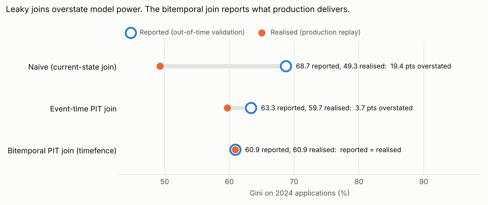
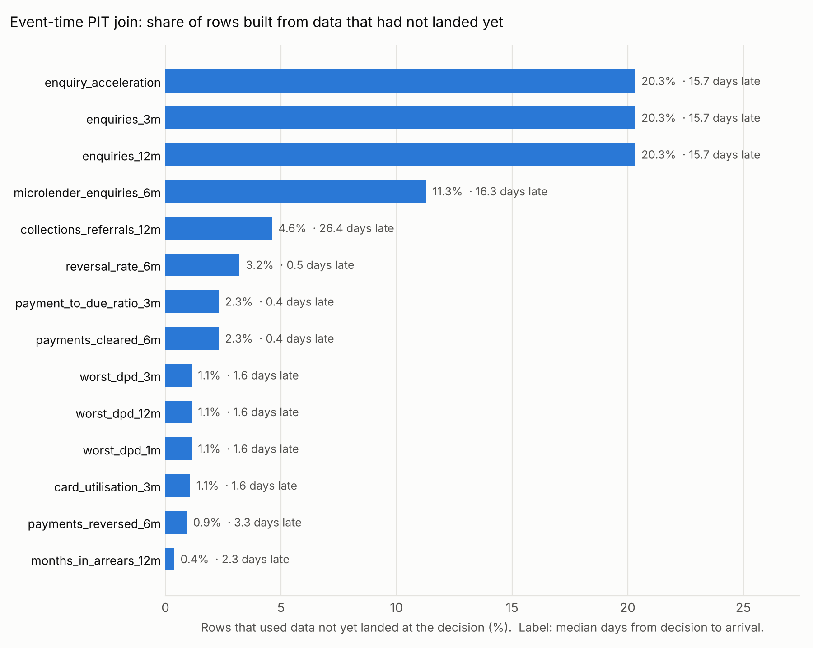

# Leakage report

Generated by `timefence experiment`. Synthetic data; numbers change with the seed.

- Applications scored: **19,261** (1,055 excluded as already in default, using point-in-time data)
- Train: decisions in 2022-2023 (12,186). Out-of-time test: decisions in 2024 (7,075).
- Production replay: 306 knowledge epochs, each a physical truncation of every source table to the rows that had landed.
- Bitemporal vs replay mismatches: **0** (across 7,075 rows x 16 features)

## Reported vs realised

| Strategy | Reported Gini | Realised Gini | Gap (95% CI) | Brier, reported / realised | Promised bad rate @80% approval | Realised bad rate, same cut-off | Audit |
|---|---|---|---|---|---|---|---|
| Naive (current-state join) | 0.687 | 0.493 | +0.194 (+0.158 to +0.227) | 0.0760 / 0.0911 | 4.7% | 6.6% | FAIL |
| Event-time PIT join | 0.633 | 0.597 | +0.037 (+0.024 to +0.051) | 0.0776 / 0.0796 | 4.9% | 5.9% | FAIL |
| Bitemporal PIT join (timefence) | 0.609 | 0.609 | +0.000 (+0.000 to +0.000) | 0.0800 / 0.0800 | 5.5% | 5.5% | PASS |

### Robustness: train only on vintages matured by 1 January 2024

As if the model had gone live on the first day of the test year (fewer training rows).

| Strategy | Train rows | Reported Gini | Realised Gini | Gap |
|---|---|---|---|---|
| Naive (current-state join) | 5,707 | 0.452 | 0.298 | +0.154 |
| Event-time PIT join | 5,707 | 0.622 | 0.591 | +0.031 |
| Bitemporal PIT join (timefence) | 5,707 | 0.608 | 0.608 | +0.000 |

## Leakage audit: event-time PIT join (all applications)

| feature | late_knowledge_rows | contaminated_pct | median_days_late | status |
|---|---|---|---|---|
| worst_dpd_1m | 219 | 1.14 | 1.6 | FAIL |
| worst_dpd_3m | 219 | 1.14 | 1.6 | FAIL |
| worst_dpd_12m | 219 | 1.14 | 1.6 | FAIL |
| months_in_arrears_12m | 73 | 0.38 | 2.3 | FAIL |
| card_utilisation_3m | 206 | 1.07 | 1.6 | FAIL |
| payments_cleared_6m | 444 | 2.31 | 0.4 | FAIL |
| payments_reversed_6m | 179 | 0.93 | 3.3 | FAIL |
| payment_to_due_ratio_3m | 444 | 2.31 | 0.4 | FAIL |
| enquiries_3m | 3913 | 20.32 | 15.7 | FAIL |
| enquiries_12m | 3913 | 20.32 | 15.7 | FAIL |
| microlender_enquiries_6m | 2175 | 11.29 | 16.3 | FAIL |
| collections_referrals_12m | 890 | 4.62 | 26.4 | FAIL |
| months_on_book | 0 | 0.0 | 0.0 | PASS |
| income_band | 0 | 0.0 | 0.0 | PASS |
| reversal_rate_6m | 619 | 3.21 | 0.5 | FAIL |
| enquiry_acceleration | 3913 | 20.32 | 15.7 | FAIL |

## Leakage audit: naive join (all applications)

| feature | future_event_rows | contaminated_pct | status |
|---|---|---|---|
| worst_dpd_1m | 19261 | 100.0 | FAIL |
| worst_dpd_3m | 19261 | 100.0 | FAIL |
| worst_dpd_12m | 19261 | 100.0 | FAIL |
| months_in_arrears_12m | 19261 | 100.0 | FAIL |
| card_utilisation_3m | 19261 | 100.0 | FAIL |
| payments_cleared_6m | 19261 | 100.0 | FAIL |
| payments_reversed_6m | 19261 | 100.0 | FAIL |
| payment_to_due_ratio_3m | 19261 | 100.0 | FAIL |
| enquiries_3m | 19261 | 100.0 | FAIL |
| enquiries_12m | 19261 | 100.0 | FAIL |
| microlender_enquiries_6m | 19261 | 100.0 | FAIL |
| collections_referrals_12m | 19261 | 100.0 | FAIL |
| months_on_book | 19261 | 100.0 | FAIL |
| income_band | 19261 | 100.0 | FAIL |
| reversal_rate_6m | 19261 | 100.0 | FAIL |
| enquiry_acceleration | 19261 | 100.0 | FAIL |

## Leakage audit: bitemporal join (all applications)

| feature | future_event_rows | late_knowledge_rows | status |
|---|---|---|---|
| worst_dpd_1m | 0 | 0 | PASS |
| worst_dpd_3m | 0 | 0 | PASS |
| worst_dpd_12m | 0 | 0 | PASS |
| months_in_arrears_12m | 0 | 0 | PASS |
| card_utilisation_3m | 0 | 0 | PASS |
| payments_cleared_6m | 0 | 0 | PASS |
| payments_reversed_6m | 0 | 0 | PASS |
| payment_to_due_ratio_3m | 0 | 0 | PASS |
| enquiries_3m | 0 | 0 | PASS |
| enquiries_12m | 0 | 0 | PASS |
| microlender_enquiries_6m | 0 | 0 | PASS |
| collections_referrals_12m | 0 | 0 | PASS |
| months_on_book | 0 | 0 | PASS |
| income_band | 0 | 0 | PASS |
| reversal_rate_6m | 0 | 0 | PASS |
| enquiry_acceleration | 0 | 0 | PASS |

## Where the served value differed from the validated value (2024 applications)

| feature | naive | event_time | bitemporal |
|---|---|---|---|
| worst_dpd_1m | 23.0% | 0.3% | 0.0% |
| worst_dpd_3m | 36.3% | 0.2% | 0.0% |
| worst_dpd_12m | 58.5% | 0.1% | 0.0% |
| months_in_arrears_12m | 65.9% | 0.3% | 0.0% |
| card_utilisation_3m | 100.0% | 0.0% | 0.0% |
| payments_cleared_6m | 55.6% | 3.3% | 0.0% |
| payments_reversed_6m | 30.9% | 1.0% | 0.0% |
| payment_to_due_ratio_3m | 96.6% | 2.9% | 0.0% |
| enquiries_3m | 48.9% | 20.6% | 0.0% |
| enquiries_12m | 80.3% | 20.6% | 0.0% |
| microlender_enquiries_6m | 45.2% | 12.0% | 0.0% |
| collections_referrals_12m | 24.3% | 4.7% | 0.0% |
| months_on_book | 100.0% | 0.0% | 0.0% |
| income_band | 0.0% | 0.0% | 0.0% |
| reversal_rate_6m | 33.5% | 1.3% | 0.0% |
| enquiry_acceleration | 72.3% | 19.4% | 0.0% |

## What each model leaned on (permutation importance, top 5, out-of-time)
Measured on the validation frame (what the model was shown) and on the production replay (what it was actually fed).

**Naive (current-state join)**
- Validation frame: `card_utilisation_3m` (0.167), `worst_dpd_12m` (0.049), `income_band` (0.015), `months_in_arrears_12m` (0.013), `enquiries_12m` (0.009)
- Production replay: `card_utilisation_3m` (0.131), `income_band` (0.025), `enquiries_12m` (0.021), `microlender_enquiries_6m` (0.011), `months_in_arrears_12m` (0.005)

**Event-time PIT join**
- Validation frame: `payment_to_due_ratio_3m` (0.058), `card_utilisation_3m` (0.048), `collections_referrals_12m` (0.042), `worst_dpd_1m` (0.028), `income_band` (0.014)
- Production replay: `payment_to_due_ratio_3m` (0.067), `card_utilisation_3m` (0.059), `collections_referrals_12m` (0.023), `worst_dpd_1m` (0.022), `income_band` (0.016)

**Bitemporal PIT join (timefence)**
- Validation frame: `card_utilisation_3m` (0.067), `payment_to_due_ratio_3m` (0.065), `worst_dpd_1m` (0.032), `income_band` (0.012), `worst_dpd_12m` (0.008)
- Production replay: `card_utilisation_3m` (0.067), `payment_to_due_ratio_3m` (0.065), `worst_dpd_1m` (0.032), `income_band` (0.012), `worst_dpd_12m` (0.008)
